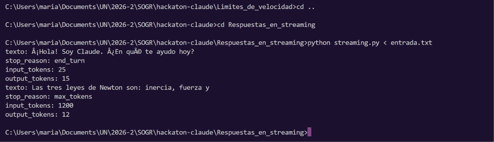
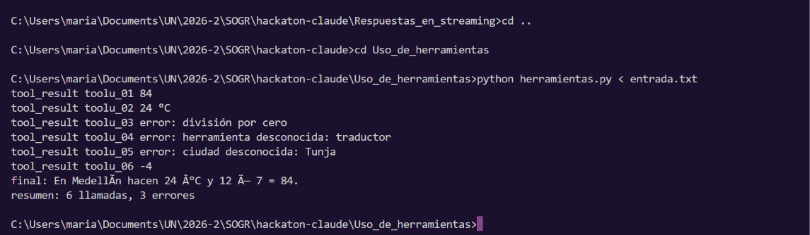
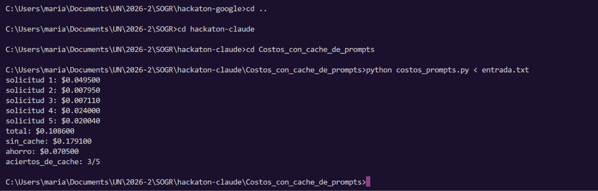
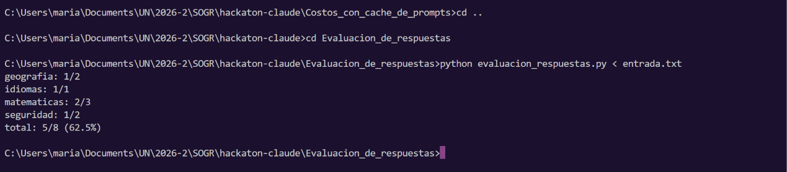

# Hackatón individual: API de Claude

Este repositorio contiene soluciones en Python para cinco ejercicios basados en
el funcionamiento de la API de Claude. Cada programa lee los datos desde la
entrada estándar y escribe el resultado en la salida estándar.

## Estructura del proyecto

```text
.
├── Costos_con_cache_de_prompts/
├── Evaluacion_de_respuestas/
├── Limites_de_velocidad/
├── Respuestas_en_streaming/
└── Uso_de_herramientas/
```

Cada carpeta contiene:

- Un archivo `.py` con la solución.
- `entrada.txt`, con un caso de prueba.
- `salida_esperada.txt`, con el resultado esperado.
- `entrada_oficial.txt`, con el caso de prueba "oficial" asignado.

## Ejercicios resueltos

### A. Respuestas en streaming

Archivo: `Respuestas_en_streaming/streaming.py`



### B. Uso de herramientas

Archivo: `Uso_de_herramientas/herramientas.py`



### C. Costos con caché de prompts

Archivo: `Costos_con_cache_de_prompts/costos_prompts.py`



### D. Límites de velocidad

Archivo: `Limites_de_velocidad/limites_velocidad.py`


### E. Evaluación de respuestas

Archivo: `Evaluacion_de_respuestas/evaluacion_respuestas.py`



## Resultado de los ejemplos

Los resultados de referencia están guardados en cada archivo
`salida_esperada.txt`. Para revisar una solución, ejecútala con su
`entrada.txt` y compara la salida obtenida con ese archivo.

